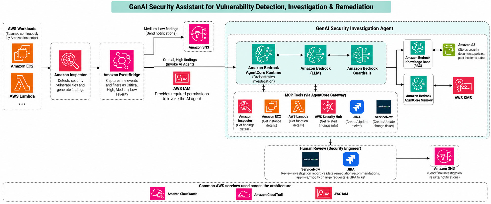

# GenAI Security Assistant for Vulnerability Detection, Investigation & Remediation

## 1. Overview

### Why did I think about this solution?

In a cloud environment, detecting vulnerabilities is only the first step. The real challenge is understanding the vulnerability, identifying the affected resources, assessing the risk and deciding how to fix it.

Security teams often need to check multiple AWS services, refer to security documents, investigate previous incidents and create tickets in tools like Jira or ServiceNow. This can take time, especially when there are many findings to investigate.

This article explores how **Generative AI and AWS services can work together to simplify this process.**

The idea is to build a GenAI-powered Security Assistant that can investigate critical and high-severity vulnerabilities, gather relevant information from AWS services, refer to security documentation, best practices, previous vulnerabilities and their solutions and suggest remediation steps.

The solution also includes a human review process so that security engineers can validate the recommendations before proceeding with remediation.

### What I wanted to achieve

- Detect vulnerabilities across Amazon EC2 and Lambda workloads using Amazon Inspector.
- Use Amazon EventBridge to route findings based on severity.
- Use a GenAI agent to investigate critical and high-severity findings.
- Retrieve relevant security policies and previous incident information using RAG.
- Integrate AWS services and tools like Jira and ServiceNow using MCP.
- Generate remediation recommendations and route them for human review.
- Use AWS security services to control access, protect data and monitor activity.

The repository documents the proposed architecture, service selection, end-to-end workflow and security considerations.

## 2. Architecture Diagram

The following diagram illustrates how the different AWS services and integrations work together.

## 3. How Does the Architecture Work?

Let’s walk through the architecture step by step.

### Step 1: Detect vulnerabilities using Amazon Inspector

This solution starts with AWS workloads such as Amazon EC2 and AWS Lambda.

Amazon Inspector continuously scans supported resources for security vulnerabilities and generates findings.

Each finding contains information about the affected resource, the vulnerability and its severity.

### Step 2: Route findings using Amazon EventBridge

Amazon EventBridge captures the relevant security finding events and routes them based on severity.

I have designed two paths:

- **Medium and Low findings:** Send notifications using Amazon SNS as immediate action not required. Upon receiving the notifications, the security team would take appropriate actions.
- **Critical and High findings:** Trigger the GenAI Security Investigation and Remediation Agent.

This approach helps prioritize critical findings for detailed investigation instead of sending every finding through the same workflow.

### Step 3: Investigate findings using a GenAI agent

For critical and high-severity findings, the investigation agent runs on Amazon Bedrock AgentCore Runtime.

The agent needs to understand more than just the vulnerability description. It needs additional information about the affected resource, its configuration, related security findings and the organization's security guidelines.

This is where the GenAI agent becomes useful.

It can gather information, analyze the available evidence and prepare an investigation report with suggested remediation steps.

The solution uses:

- **Amazon Bedrock:** Provides the foundation model for analyzing information and generating recommendations.
- **Amazon Bedrock Guardrails:** Helps apply configured safety controls to model inputs and outputs.
- **Amazon Bedrock AgentCore Runtime:** Runs and coordinates the investigation agent.

### Step 4: Fetch information using MCP tools

The agent needs access to different AWS services and operational tools to investigate a finding properly.

I have used MCP (Model Context Protocol) to structure the integration between the agent and these tools, with Amazon Bedrock AgentCore Gateway providing the tool integration layer.

The tools shown in my architecture include:

| Tool | Purpose |
|---|---|
| Amazon Inspector | Retrieve vulnerability details |
| Amazon EC2 | Get instance details |
| AWS Lambda | Get function details |
| AWS Security Hub | Retrieve related security findings |
| Jira | Create or update investigation tickets |
| ServiceNow | Create or update incidents and change requests |

For example, if Amazon Inspector reports a vulnerability on an EC2 instance, the agent can retrieve additional instance details and check for related security findings.

It can then use this information to understand the issue better before suggesting remediation.

The important point is that the agent can retrieve information from the actual systems rather than relying only on the original finding or the model's existing knowledge.

Tool permissions must be configured carefully, with read-only access separated from operations that create or modify tickets.

### Step 5: Use RAG to retrieve security knowledge

A vulnerability investigation may also require internal security policies, remediation guidelines, architecture documents, or information about previously resolved incidents.

For this, I have included Amazon Bedrock Knowledge Bases, Amazon S3, and AWS KMS in the architecture.

The flow is straightforward:

1. Store relevant security documents and approved reference material in Amazon S3.
2. Configure Amazon Bedrock Knowledge Bases to process and retrieve information from these documents.
3. During an investigation, retrieve the documents relevant to the vulnerability.
4. Use this context along with the information gathered through MCP tools to generate more useful recommendations.

For example, if a finding relates to an insecure security group configuration, the agent could retrieve the organization's network security guidelines and recommend changes based on those guidelines.

This is the benefit of RAG: the model can use relevant organizational knowledge instead of depending only on its general training.

AWS KMS supports encryption at rest for configured resources, helping protect sensitive security information.

### Step 6: Generate remediation recommendations

Once the agent has gathered the required information, the foundation model analyzes the evidence and prepares an investigation report.

The report could include:

- What the vulnerability is.
- Which resource is affected.
- Why the finding needs attention.
- What additional risks or related findings were identified.
- Recommended remediation steps.
- What should be validated after remediation.

For example, the agent might recommend restricting an overly permissive security group, updating a vulnerable software package, or reviewing an IAM policy.

These are recommendations, not automatic infrastructure changes. The proposed action must be validated against the actual resource configuration and the organization's change-management process.

### Step 7: Send notifications using Amazon SNS

Based on the investigation, the agent generates a report which is sent to the security team using Amazon SNS. Also the agent creates JIRA and ServiceNow tickets.

The notification can include the finding summary, investigation outcome, recommended action and associated ticket reference.

### Step 8: Human review using ServiceNow and Jira

I have included a human review stage because security-related changes, especially in production, should not be executed blindly by an AI agent. This helps security and operations teams understand what was found and what needs to happen next.

The investigation report and proposed actions are sent for review to the security engineer.

The engineer can:

- Validate the investigation results.
- Review the suggested remediation.
- Approve or modify the proposed changes.
- Update the relevant Jira ticket or ServiceNow change request.

Only authorized and approved actions should proceed through the remediation process.

This keeps the security engineer involved in important decisions while allowing AI to reduce the manual effort involved in investigation.

### Step 9: Apply security and monitoring controls

Security and monitoring are important across the entire architecture.

I have included the following services:

- **AWS IAM:** Controls access to AWS resources, the agent, and its tools.
- **AWS CloudTrail:** Helps audit supported AWS API activity.
- **Amazon CloudWatch:** Provides logs, metrics, and alarms for monitoring the solution.
- **AWS KMS:** Supports encryption of data at rest for configured resources.
- **Amazon Bedrock Guardrails:** Helps apply configured safety controls to model inputs and outputs.

The agent should only have the permissions required for its tasks. Access to sensitive documents and ticketing systems must also be restricted.

## 4. A Simple Example

Let's say Amazon Inspector detects a critical vulnerability on an EC2 instance.

Here is how the solution would handle it:

1. Amazon Inspector generates the finding.
2. Amazon EventBridge identifies it as a critical finding and triggers the investigation workflow.
3. The GenAI agent retrieves the finding details and EC2 configuration through MCP tools.
4. The agent checks for related findings in AWS Security Hub.
5. Amazon Bedrock Knowledge Bases retrieves relevant security policies and remediation guidelines.
6. The foundation model analyzes the collected information and prepares a remediation recommendation.
7. The investigation report and proposed actions(by creating ServiceNow and Jira ticket) are sent to the relevant team using SNS notifications.
8. The security engineer validates the recommendations and approves or modifies the proposed action.

Instead of manually collecting information from different systems and preparing the initial investigation report, the security engineer receives a consolidated view of the issue and can focus on validating the findings and deciding the next steps.

## 5. Important Design Considerations

While designing this solution, I would pay attention to a few things:

- **Least privilege:** Give the agent and its tools only the permissions they need.
- **Human approval:** Keep approval controls for production changes and other high-impact actions.
- **Reliable recommendations:** Ground recommendations in actual findings, resource details and approved security documents.
- **Data protection:** Encrypt sensitive data and restrict access to investigation reports and stored documents.
- **Audit trail:** Track tool calls, investigation results, approval decisions and remediation outcomes.
- **Cost optimization:** Trigger detailed AI investigations selectively based on severity and business requirements.

## 6. What I Learned from This Architecture

This architecture brings together several concepts that are useful when designing AI-powered solutions on AWS:

- Event-driven processing using Amazon EventBridge and Amazon SNS.
- Agent orchestration using Amazon Bedrock AgentCore Runtime.
- Foundation models and safety controls using Amazon Bedrock.
- RAG using Amazon Bedrock Knowledge Bases and Amazon S3.
- Tool integration using MCP and Amazon Bedrock AgentCore Gateway.
- Security and governance using IAM, KMS, CloudTrail and CloudWatch.
- Human-in-the-loop approval for security-related actions.

The key takeaway for me is that **building a GenAI solution is not just about integrating an LLM.** The real value comes from connecting the model to relevant data and tools, controlling what it can access and execute and ensuring that the results fit into an existing operational workflow.

## 7. Conclusion

This is a practical use case for applying GenAI to cloud security operations.

By combining vulnerability detection, contextual investigation, knowledge retrieval and controlled remediation workflows, a GenAI Security Assistant can help reduce manual investigation effort and provide security engineers with more actionable information.

The objective is not to replace security teams, but to help them investigate faster, make better-informed decisions and manage vulnerabilities more efficiently.

